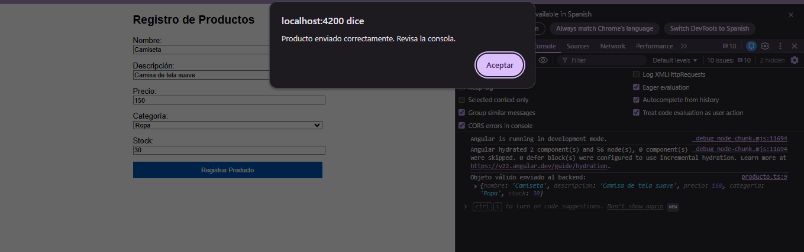

# Actividad 2: Formulario Reactivo de Registro de Productos en Angular
---

## 1. Descripción de la Actividad
En esta actividad desarrollé un formulario reactivo en Angular enfocado en el registro de productos. La aplicación cuenta con validaciones sobre cada campo, mostrando mensajes de error dinámicos en tiempo real según la interacción del usuario. Además, integré un servicio para simular el envío de los datos al backend únicamente cuando la información ingresada es válida.

---

## 2. Modelo de Datos (`Producto`)
Creé la interfaz `Producto` en la ruta `src/app/models/producto.ts` para estructurar la información que maneja el formulario:

- `nombre` (string): Nombre del producto.
- `descripcion` (string): Detalles o especificaciones del producto.
- `precio` (number): Valor monetario del producto.
- `categoria` (string): Categoría a la que pertenece el producto.
- `stock` (number): Cantidad disponible en inventario.

---

## 3. Validaciones y Estados del Formulario
Construí el formulario utilizando `FormBuilder` y le asigné las siguientes reglas de validación:

- **Nombre:** Campo obligatorio (`Validators.required`) con una longitud mínima de 3 caracteres (`Validators.minLength(3)`).
- **Descripción:** Campo obligatorio (`Validators.required`).
- **Precio:** Campo obligatorio (`Validators.required`) y debe ser un valor mayor a 0 (`Validators.min(0.01)`).
- **Categoría:** Selección obligatoria (`Validators.required`).
- **Stock:** Campo obligatorio (`Validators.required`) con un mínimo de 1 unidad (`Validators.min(1)`).

Para controlar el flujo de envío, el botón se deshabilita mientras el formulario sea inválido mediante `[disabled]="productoForm.invalid"`. Asimismo, si se intenta enviar el formulario, ejecuto `markAllAsTouched()` para resaltar visualmente los campos pendientes.

---

## 4. Uso de Directivas Estructurales (*ngIf y *ngFor)
- **`*ngIf`:** Lo utilicé para evaluar si un control ha sido interactuado (`touched`) y si es inválido (`invalid`), desplegando de forma dinámica los mensajes de error correspondientes debajo de cada campo.
- **`*ngFor`:** Lo empleé para iterar sobre un listado de categorías en el componente y renderizar las opciones dentro del elemento desplegable (`<select>`).

---

## 5. Servicio e Inyección de Dependencias
Inyecté el servicio `ProductoService` en mi componente mediante la función `inject()`. Al procesar el envío, la lógica valida que el estado de `productoForm.valid` sea correcto. Si se cumplen los requisitos, los datos son transmitidos al servicio, el cual imprime el objeto en la consola del navegador como prueba de recepción.

---

## 6. Pruebas y Evidencia de Funcionamiento

A continuación adjunto la captura de pantalla donde se aprecia el formulario lleno con datos válidos y la confirmación de llegada en la consola del navegador:

